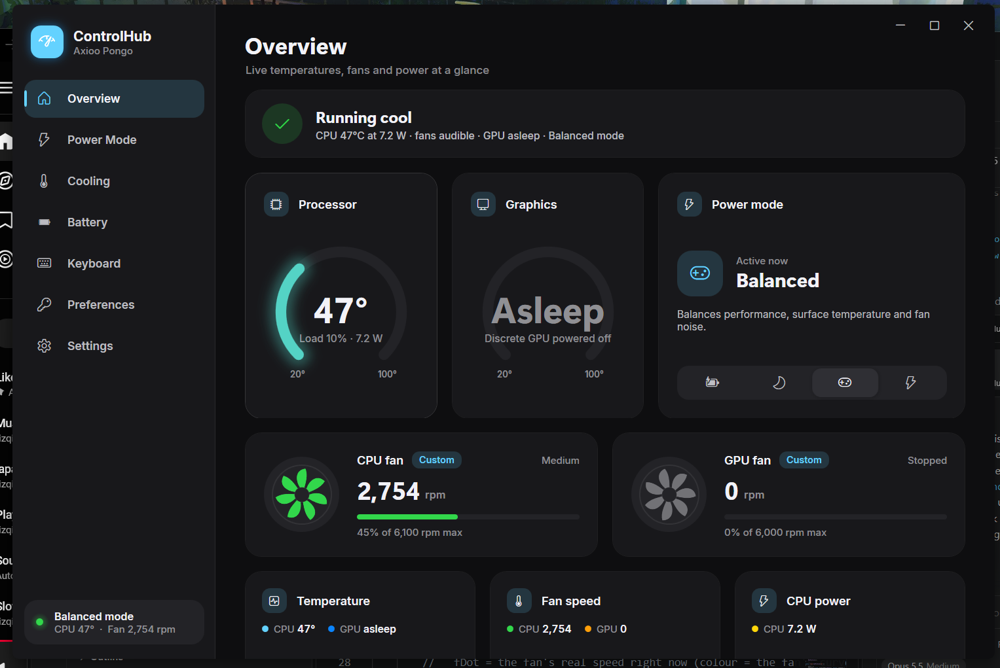
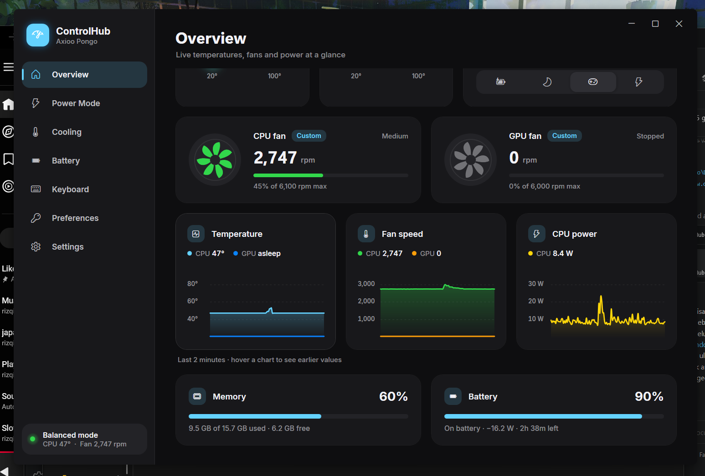
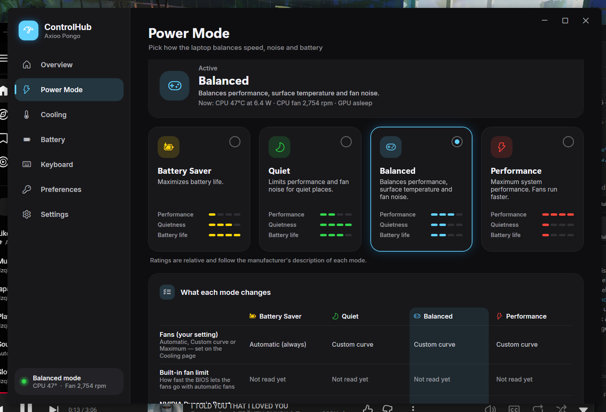
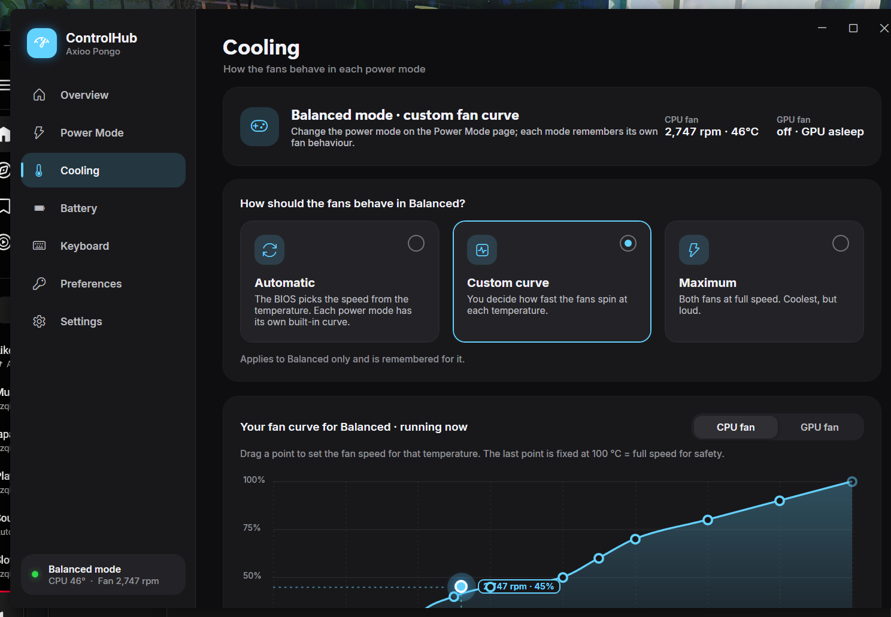
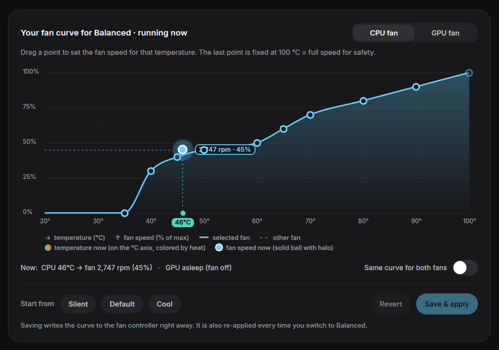
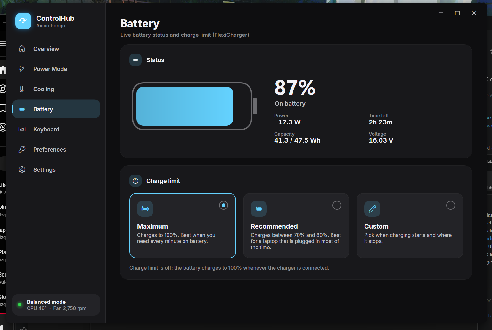
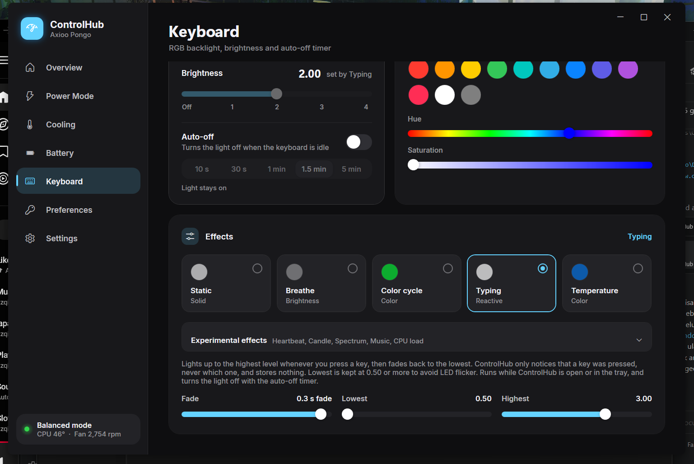
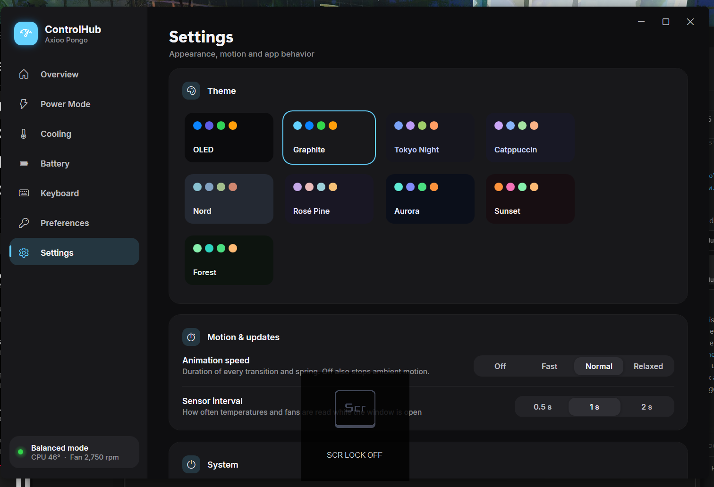

# ControlHub

**A fast, good-looking replacement for the Control Center on Axioo Pongo laptops (Clevo-based).**
Power modes, custom fan curves, battery charge limit, RGB keyboard with software effects, special keys, all in one
native Windows app that opens instantly and stays out of your way in the tray.

> **Unofficial project.** ControlHub is not made, endorsed or supported by Axioo, Clevo or Insyde.
> It talks to the laptop through the same vendor driver and the same commands the official Control Center uses.



---

## Contents

- [Why](#why)
- [Highlights](#highlights)
- [Feature tour](#feature-tour)
- [Compatibility](#compatibility)
- [Requirements](#requirements)
- [Install and build](#install-and-build)
- [Using ControlHub](#using-controlhub)
- [Safety: what ControlHub changes and how to undo it](#safety-what-controlhub-changes-and-how-to-undo-it)
- [Testing on another model (755, 775, ...)](#testing-on-another-model-755-775-)
- [Troubleshooting](#troubleshooting)
- [How it works](#how-it-works)
- [Command-line / IPC reference](#command-line--ipc-reference)
- [Project layout](#project-layout)
- [Contributing](#contributing)
- [Known limitations](#known-limitations)
- [License and credits](#license-and-credits)
- [Ringkasan (Bahasa Indonesia)](#ringkasan-bahasa-indonesia)

---

## Why

The stock Control Center (CC40/CC60, inside the "Fn hotkeys and OSD" app) works, but it is slow to open, hard to read and
hides useful things: you can't see what a power mode actually changes, fan curves are tiny step charts, the keyboard has
only four brightness levels and no effects, and there is no live view of temperatures and fans.

ControlHub keeps every feature people use, drives the hardware **exactly the way the official app does**, and adds the
missing parts on top.

## Highlights

| | |
|---|---|
| **Live overview** | CPU/GPU temperature gauges, both fans with real rpm, CPU package power (RAPL), memory and battery, 2-minute history charts with hover read-out. |
| **Power modes** | Battery Saver, Quiet, Balanced and Performance in one click, with a plain-language table of what each mode really changes (fan behaviour, built-in fan limit, NVIDIA Dynamic Boost, screen refresh rate). |
| **Custom fan curves** | Drag a smooth 10-point curve per fan and per power mode, see the live temperature and fan speed on the chart, start from Silent / Default / Cool presets. Written to the fan controller and verified by reading it back. |
| **Battery charge limit** | FlexiCharger: Maximum, Recommended (70–80 %) or Custom start/stop, plus live power draw, capacity, voltage and time left. |
| **RGB keyboard** | Any color (presets, hue, saturation), **fine brightness 0.00–4.00** instead of 4 steps, auto-off timer, and **10 software effects**: Static, Breathe, Color cycle, Typing, Temperature, plus experimental Heartbeat, Candle, Spectrum, Music and CPU load. |
| **Special keys and devices** | Fn-key lock, Win-key lock, swap Win/Fn, touchpad, camera, airplane mode, and Caps/Num/Scroll lock indicators. |
| **Built for daily use** | Opens instantly, lives in the tray, starts with Windows if you want, 9 color themes, smooth spring animations (adjustable or off), keyboard shortcuts, nice on-screen toasts. |
| **Light on resources** | Sensors are polled once per second while the window is open and every 5 s when it's hidden. No services, no telemetry, no network access. |
| **Careful by design** | Only replicates commands the official software sends, logs every hardware write, keeps a backup of the original fan profile file, and has a dry-run mode for testing. |

## Feature tour

### Overview

Everything at a glance: a one-line health summary ("Running cool · CPU 47 °C at 7.2 W · fans audible · GPU asleep"),
temperature gauges, the active power mode with a quick switcher, live fan cards with spinning rotors, history charts
for temperature, fan speed and CPU power, memory use and battery status.

| | |
|---|---|
|  |  |

### Power Mode

Four mode cards with relative performance / quietness / battery ratings, and a **"What each mode changes"** table built
only from real data: your fan setting for that mode, the BIOS fan limit (read from the fan controller with
**Read built-in fan limits**), NVIDIA Dynamic Boost and screen refresh rate behaviour. Optional: also drop to 60 Hz in
Quiet/Battery Saver while on the charger (the vendor app only does it on battery).



### Cooling

Pick how the fans behave **per power mode**: Automatic (BIOS curve), Custom curve or Maximum.

- Smooth, monotone curve editor (it never overshoots between points). The last point is locked to 100 °C = 100 % for safety.
- Separate curves for the CPU fan and the GPU fan, or "Same curve for both fans".
- Live markers: the **temperature** rides the °C axis (colored by heat) and the **fan speed** is the solid ball above it,
  labelled with rpm and %.
- Presets (Silent, Default, Cool), Revert, and a confirmation before unsaved changes are discarded.
- Prepare the curve of another power mode before switching to it ("Curves for other power modes").
- In Automatic, see the BIOS curve of the current mode with live markers.

| | |
|---|---|
|  |  |

### Battery

Live battery status (percentage, charge/discharge power, capacity, voltage, time left) and the FlexiCharger charge
limit: **Maximum** (100 %), **Recommended** (charge between 70 % and 80 %, best when the laptop is mostly plugged in) or
**Custom** start/stop thresholds chosen from the values the firmware accepts.



### Keyboard

- Live keyboard preview that mirrors the real backlight, including effects.
- Color presets, hue and saturation sliders.
- **Fine brightness** from 0.00 to 4.00 (the firmware only offers 4 steps; ControlHub interpolates between them).
- Auto-off timer (10 s – 5 min).
- **Effects** (software, run while ControlHub is open or in the tray):

| Effect | What it does | Controls |
|---|---|---|
| Static | Plain color and brightness | – |
| Breathe | Smoothly rises and falls in your color | Speed, Lowest, Highest |
| Color cycle | Travels around the color wheel | Speed |
| Typing | Lights up on every key press, then fades | Fade, Lowest, Highest |
| Temperature | Blue → green → yellow → orange → red with CPU temperature | – |
| *Heartbeat* (experimental) | Double pulse like a heartbeat | BPM, Lowest, Highest |
| *Candle* (experimental) | Restless flickering glow | Flicker, Lowest, Highest |
| *Spectrum* (experimental) | Breathes and changes color at its dimmest point | Speed, Lowest, Highest |
| *Music* (experimental) | Brightness follows what's playing on your speakers | Sensitivity, Lowest, Highest |
| *CPU load* (experimental) | Green → red with processor load | – |

Effects respect the Fn-key backlight toggle and the auto-off timer, never go below brightness 0.50 (LEDs flicker below
that), and restore your static look when stopped or when ControlHub exits. The Typing effect only notices *that* a key
was pressed, never which one, and stores nothing.

| | |
|---|---|
|  |  |

### Preferences

Fn-key lock, Win-key lock, swap Win/Fn, touchpad, camera and airplane mode toggles, plus Caps / Num / Scroll lock
state, with an on-screen toast when something changes.


### Settings

Nine themes (OLED, Graphite, Tokyo Night, Catppuccin, Nord, Rosé Pine, Aurora, Sunset, Forest), animation speed
(Off / Fast / Normal / Relaxed), sensor interval, close-to-tray, start with Windows, device info and a button to open the log.



---

## Compatibility

ControlHub is developed and tested on an **Axioo Pongo 765**. The Pongo 755 and Pongo 775 are expected to work because
they share the same Clevo platform and Axioo ships the **same Control Center / "Fn hotkeys and OSD" package** for them,
but they have **not been tested yet**.

| Model | Status | Notes |
|---|---|---|
| [x] **Axioo Pongo 765** | **Tested**, every feature | Reference machine (details below) |
| [ ] Axioo Pongo 755 | Expected to work, untested | Please run the [test checklist](#testing-on-another-model-755-775-) and report |
| [ ] Axioo Pongo 775 | Expected to work, untested | Please run the [test checklist](#testing-on-another-model-755-775-) and report |
| [ ] Other Clevo-based laptops using CC40 / "Fn hotkeys and OSD" | Unknown | May work partially; start in dry-run mode |

Per-feature status on the reference machine:

| Feature | Pongo 765 | Pongo 755 | Pongo 775 |
|---|---|---|---|
| Sensors (temps, fan rpm) | [x] | [ ] | [ ] |
| Power mode switching | [x] | [ ] | [ ] |
| Fan mode Auto / Custom / Max | [x] | [ ] | [ ] |
| Custom fan curve write + verify | [x] | [ ] | [ ] |
| FlexiCharger charge limit | [x] | [ ] | [ ] |
| Keyboard color and brightness | [x] | [ ] | [ ] |
| Keyboard fine brightness | [x] | [ ] | [ ] |
| Keyboard effects | [x] | [ ] | [ ] |
| Win-key lock | [x] | [ ] | [ ] |
| Fn-key lock / swap Win-Fn | [x] | [ ] | [ ] |
| Touchpad / camera / airplane toggles | [x] | [ ] | [ ] |
| Lower refresh rate on charger | [x] | [ ] | [ ] |

**Reference machine (Pongo 765) values.** Use them to compare when testing another model:

| Item | Pongo 765 |
|---|---|
| Model / board (WMI) | `Axioo` / `Pongo 765`, board `Axioo Pongo 765` |
| BIOS | `1.07.05TAX2` (2025-07-14) |
| CPU / GPU | Intel Core i7-13620H / NVIDIA GeForce RTX 5060 Laptop + Intel UHD |
| Vendor app | `CLEVOCO.FnhotkeysandOSD` 7.101.0.0, `CC40.exe` running as SYSTEM |
| Fan count (`GetDCHU_Data_Buffer(13)[12]`) | 2 |
| Keyboard type (`Buffer(13)[15]`) | 6 = single-zone RGB |
| Fan max rpm (EC table) | CPU 6100, GPU 6000 |
| Quiet mode BIOS fan cap | 2300 rpm (≈38 %) |
| FlexiCharger allowed start / stop | 40 50 60 70 80 95 / 60 70 80 90 100 |
| Display refresh rates | 60 Hz, 165 Hz |
| Fan profile file | `C:\ComboKey\profile_Fan.xml` |

## Requirements

- Windows 10 or 11, 64-bit.
- .NET Framework 4.8 (built into Windows 10/11).
- The vendor's **"Fn hotkeys and OSD"** app (`CLEVOCO.FnhotkeysandOSD`, the package that contains Control Center),
  installed and running. ControlHub uses its driver DLL, and its background service applies power modes and fan
  profiles. Get it from Axioo's driver/support page for your model if it is missing.
- **No admin rights** needed for normal use.

## Install and build

There is no installer: ControlHub is a single exe next to a `lib` folder.

```powershell
git clone <this repo> ControlHub
cd ControlHub

# 1. copy the vendor DLLs into .\lib (they are not shipped in this repo)
powershell -ExecutionPolicy Bypass -File .\setup-lib.ps1

# 2. build (uses the C# compiler that ships with Windows' .NET Framework, no Visual Studio needed)
.\build.bat

# 3. run
.\ControlHub.exe
```

`setup-lib.ps1` finds the installed vendor package and copies `InsydeDCHU.dll`, `InsydeAirplanemodehid.dll` and the
MSVC runtime from `FnKey\CC40` into `.\lib`. Windows doesn't let other apps load DLLs straight out of `WindowsApps`,
so a private copy is needed. The originals are not touched.

Run the setup script again after the vendor app updates.

## Using ControlHub

- **Tray icon:** closing the window hides it to the tray (can be turned off in Settings). Click the tray icon to open
  the window; right-click it to switch power mode or quit.
- **Start with Windows:** Settings → System. Starts hidden in the tray.
- **Shortcuts:** `Ctrl+1` … `Ctrl+7` jump to a page, `Ctrl+Tab` / `Ctrl+Shift+Tab` cycle pages.
- **Your settings** live in `%LOCALAPPDATA%\ControlHub\settings.ini`. The **log** is `%LOCALAPPDATA%\ControlHub\log.txt`
  (Settings → Open log).
- **Coexisting with the vendor app:** both can stay installed. The vendor service keeps handling the Fn keys and OSD.
  Settings changed in either app are visible to the other because they share the same firmware storage.

## Safety: what ControlHub changes and how to undo it

ControlHub was built with one rule: **only do what the official Control Center does, the same way it does it.**

- **Every hardware write is logged** in `log.txt` (`WRITE wmi ...`, `WRITE app ...`, `WRITE package ...`, `EVENT ...`, `POWER ...`).
  The only writes that aren't logged one by one are keyboard-effect animation frames.
- **Dry-run mode:** start with `ControlHub.exe --dry` (or send `--ipc dry on`). Every write is logged with `[dry]` and
  **nothing is sent to the laptop**. Use this first on an untested model.
- **Fan profile backup:** before ControlHub writes `C:\ComboKey\profile_Fan.xml` for the first time, the original is
  copied to `%LOCALAPPDATA%\ControlHub\profile_Fan.original.xml`.
- **Fan safety:** the curve editor keeps the last point at 100 °C = 100 %, forces at least 70 % above 85 °C, and never
  enables Custom fans in Battery Saver (the vendor service would otherwise rebuild the profile file).
- **Keyboard effects:** never drive the LEDs below brightness 0.50, and restore the static color/brightness when stopped.

**To undo everything:**

1. In ControlHub: Cooling → Automatic for each power mode, Battery → Maximum, Keyboard → Static.
2. Optional: restore `profile_Fan.original.xml` to `C:\ComboKey\profile_Fan.xml`.
3. Delete the ControlHub folder and `%LOCALAPPDATA%\ControlHub`, and turn off "Start with Windows" first (or delete the
   `ControlHub` value under `HKCU\Software\Microsoft\Windows\CurrentVersion\Run`).

The vendor Control Center keeps working the whole time.

---

## Testing on another model (755, 775, ...)

Thanks for helping! The goal is to confirm every feature reads the right values **before** anything is written.
Work through the steps in order and stop at the first one that looks wrong.

### Step 0: before you start

- [ ] The vendor app is installed: `Get-AppxPackage CLEVOCO.FnhotkeysandOSD` shows a version.
- [ ] Its service is running: Task Manager → Details shows `CC40.exe` (user SYSTEM).
- [ ] The official Control Center works (power modes switch, keyboard light changes).
- [ ] Note your current settings (power mode, fan mode, keyboard color/brightness, charge limit) so you can put them back.

### Step 1: read-only hardware report

```powershell
powershell -ExecutionPolicy Bypass -File .\setup-lib.ps1
.\probe\diagnose.bat
```

`probe\diagnose.bat` builds and runs the **read-only** probes and writes `probe\diag_report.txt` with your model, BIOS,
vendor app version, raw sensor buffers, fan tables, charge limit state and firmware settings. Nothing is written to the
laptop. **Attach this file to your issue.**

Check in the report:

- [ ] `Manufacturer`, `Model`, `Board`, `BIOS` are filled in (that's how we tell models apart).
- [ ] `FnKey app` shows a version and `CC40 running: True`.
- [ ] `BUF 12 ret=12` and `BUF 13 ret=13`. If `ret` is 0 or the probe crashes, the driver DLL isn't working on your machine.
- [ ] `FAN sample` lines: `cpuT` is a believable CPU temperature, `rpm1` matches what you hear / what HWiNFO shows.
      `gpuT=20` and `rpm2=0` are normal while the NVIDIA GPU sleeps.
- [ ] `FanTable`: `FanMax_RPM` looks sane (Pongo 765: 6100 / 6000) and the `pt0..pt9` temperatures go up.
- [ ] `Charge`: `ret=4` and the allowed start/stop lists are not empty (if FlexiCharger exists on your model).

### Step 2: ControlHub in dry-run mode

```powershell
.\ControlHub.exe --dry
```

Nothing is written in this mode. Check every page:

- [ ] **Overview:** CPU temperature, fan rpm, CPU power and battery match HWiNFO / Task Manager within a few units.
- [ ] **GPU:** wake the NVIDIA GPU (open a game or `nvidia-smi`): GPU temperature and the GPU fan show up.
- [ ] **Fan count:** you see 2 fan cards (if your model has a different count, report it).
- [ ] **Keyboard:** the label under the preview says **"Single-zone RGB"**. If it says "Keyboard type N", your keyboard
      is different (per-key RGB, white only, ...): note N and **don't use the keyboard page**.
- [ ] **Power Mode:** the highlighted mode is the one the official app shows.
- [ ] **Cooling:** the selected behaviour (Automatic / Custom / Maximum) matches the official app for the current mode.
- [ ] **Battery:** charge limit choice matches the official app.
- [ ] **Preferences:** Fn lock / Win lock / swap states match the official app.
- [ ] Click things: the log (`%LOCALAPPDATA%\ControlHub\log.txt`) shows `WRITE ... [dry]` lines and nothing changes on the laptop.

### Step 3: real writes, one feature at a time

Quit and start ControlHub normally (`.\ControlHub.exe`). After each test, confirm in the **official** Control Center
that it sees the same change, then put your setting back.

- [ ] **Keyboard:** change color, then brightness 1 → 4 → 2, then a fine value like 1.50. Turn the light off and on with Fn.
- [ ] **Keyboard effects:** Breathe for a few seconds, then back to Static. Your color and brightness come back.
- [ ] **Power mode:** switch Quiet → Balanced → Performance → Battery Saver → back to yours. The vendor OSD appears and
      the fan noise changes.
- [ ] **Fans, Maximum:** set Maximum in Cooling: fans spin up within a few seconds. Set back.
- [ ] **Fans, Custom curve:** in Balanced, set Custom curve, press **Save & apply** without editing. The toast says
      "Fan curve applied" (it's verified by reading the fan controller back). Then try a gentle preset and watch the
      live ball follow the curve. Set back to your previous mode.
- [ ] **Battery:** Recommended → check the official app shows 70–80 % → back to your choice.
- [ ] **Win-key lock:** on → the Windows key does nothing → off.
- [ ] Touchpad, camera, airplane: optional, each toggle should match the official app.

### Step 4: report

Open an issue titled `Compatibility: Pongo 7xx` with:

- `probe\diag_report.txt`
- the checklist above with what passed/failed
- `%LOCALAPPDATA%\ControlHub\log.txt` from the session (it contains no personal data, only hardware commands)
- screenshots of anything that looks wrong

When everything passes, the model gets its box ticked in the [compatibility table](#compatibility).

### What could differ on another model, and where it lives in the code

| Possible difference | Symptom | Where to look |
|---|---|---|
| Fan count or fan tach offsets | Missing / zero GPU fan, wrong rpm | `Hw.Poll` in `Hardware.cs` (buffer 12 offsets `[2..7]`, `[36..37]`, duty `[16]`, `[19]`, `[22]`, `[38]`) |
| Temperature offsets | Wrong or constant temperatures | `Hardware.cs` (buffer 12 `[18]` CPU, `[21]` GPU) |
| Keyboard type ≠ 6 | Wrong colors, effects misbehave | `Hw.PackColor`, `Hw.FineValue`, `KbFx` in `Effects.cs` |
| Different fan max rpm / table layout | Curves saved but fans don't follow | `WriteCurveToEc` / EC table blocks (package cmd 4, sub 40/41) in `Hardware.cs` |
| Fan profile indexes | Custom curve applied to the wrong mode | `CurveCard.ProfileIdx` in `Fans.cs`, `FanProfiles` in `Hardware.cs` |
| Power mode numbers | Wrong mode highlighted | `Modes` in `Window.cs` (1 saver, 4 quiet, 3 balanced, 2 performance) |
| No FlexiCharger | Battery page shows "–" | `ChargeState`, package cmd 4 sub 30/31 |
| Different refresh rates | Refresh option does nothing | `Display.cs` |

---

## Troubleshooting

| Problem | Fix |
|---|---|
| Everything shows 0 / "Reading sensors…" | `lib\InsydeDCHU.dll` missing: run `setup-lib.ps1`. Check the log for `DCHU init failed`. |
| `setup-lib.ps1` says the app isn't installed | Install "Fn hotkeys and OSD" / Control Center from Axioo's support page for your model. |
| Power mode doesn't change | The vendor service applies it. Make sure `CC40.exe` is running (reboot, or reinstall the vendor app). |
| Custom fan curve "saved, but the fan controller didn't confirm it" | The EC table layout may differ on your model: go back to Automatic and report it with `diag_report.txt`. |
| GPU shows "Asleep" | Normal: the NVIDIA GPU is powered off when idle (Optimus). It wakes when an app uses it. |
| Keyboard effect stops when I press Fn+backlight | By design: effects pause when you turn the light off and resume when it's back on. |
| Refresh rate doesn't drop in Quiet | The vendor service only lowers it on battery. Enable "Also lower the refresh rate on the charger" on the Power Mode page. |
| Build fails: file in use | Quit ControlHub first (tray → Quit, or `ControlHub.exe --ipc quit`). |
| Anything else | Settings → Open log, and open an issue with the log and `diag_report.txt`. |

## How it works

```
 ControlHub.exe (WPF, C#)
   ├─ Hw worker thread ── InsydeDCHU.dll ── vendor ACPI/WMI driver ── embedded controller (EC)
   │     sensors, keyboard, fan tables, FlexiCharger, firmware app settings
   ├─ Windows Event Log "OutLog" ── vendor service (FnKey / CC40) ── power mode, fan mode, OSD
   ├─ kbfx thread ── keyboard effects (software animation, only changed values are sent)
   └─ Core Audio / WMI / performance counters ── battery, CPU power (RAPL), audio level
```

Protocol notes (all verified on the Pongo 765):

| What | How |
|---|---|
| Live sensors | `GetDCHU_Data_Buffer(12)`: CPU temp `[18]`, GPU temp `[21]`, fan tach (big-endian) `[2..3]`, `[4..5]`, rpm = 120 / (5.565217391304348e-5 × raw) |
| Capabilities | `GetDCHU_Data_Buffer(13)`: fan count `[12]`, keyboard type `[15]` |
| Firmware app settings | `ReadAppSettings` / `WriteAppSettings`, id = page × 256 + offset: 257 power mode, 547 kb level, 592 kb on, 593 kb RGB, 1029 fan mode, 302 charge choice, 292–294 Fn/Win/Swap |
| Power mode | Event `clevocc30^101^N` written to log `OutLog`, source `PowerBIOSServer_Out`; the vendor service applies it (1 saver, 4 quiet, 3 balanced, 2 performance) |
| Fan mode | `SetDCHU_Data(121, sub 1, mode)` + event `clevofan^113^mode` + app 1029 + per-mode slot (0 auto, 1 max, 6 custom) |
| Fan curves | `C:\ComboKey\profile_Fan.xml` + EC table via package cmd 4 (sub 40 read, sub 41 write), verified by reading back |
| Keyboard | `SetDCHU_Data(103, sub 244, level)`, color subs 240–242 packed as (B/2)<<16 \| (R/2)<<8 \| G/2 |
| FlexiCharger | package cmd 4 sub 30 read, sub 31 write `[status, start, stop]` |
| Keys | package `[25, fn, win, swap, 0, 0]` + app 292–294 |

## Command-line / IPC reference

ControlHub is single-instance. A second `ControlHub.exe --ipc <command>` talks to the running instance over a named pipe
(handy for testing and scripts). In PowerShell, append `| Out-String` so it waits for the reply.

| Command | Does |
|---|---|
| `--dry` (start-up flag) | Dry-run: log writes, send nothing |
| `--ipc show` / `hide` / `quit` | Window control |
| `--ipc state` | One-line sensor + keyboard + driver status |
| `--ipc page <name>` | Open a page (`overview`, `power`, `cooling`, `battery`, `keyboard`, `preferences`, `settings` or index 0–6) |
| `--ipc shot <file.png>` | Screenshot of the window |
| `--ipc dry on\|off` | Toggle dry-run |
| `--ipc mode <1\|4\|3\|2>` | Power mode |
| `--ipc fan state\|mode <0\|1\|6>\|refresh` | Fan info / fan mode |
| `--ipc charge state\|set <0\|1\|2> [start stop]\|refresh` | Charge limit |
| `--ipc pref state\|set fn\|win\|swap on\|off` | Special keys |
| `--ipc kb level <0-4>\|fine <0.00-4.00>\|color #rrggbb\|sleep on\|off [sec]\|fx <0-9>\|refresh` | Keyboard |
| `--ipc display` | Current and available refresh rates |
| `--ipc palette <key>` / `anim <scale>` | Theme / animation speed |

## Project layout

| Path | What |
|---|---|
| `App.cs` | Entry point, settings, tray, single instance, IPC |
| `Window.cs` | Main window, navigation, power-mode model, toasts, dialogs |
| `Pages.cs` | Overview, Power Mode, Keyboard and Settings pages |
| `Fans.cs` | Cooling page and the fan curve editor |
| `Battery.cs` | Battery page and FlexiCharger |
| `Prefs.cs` | Preferences page (keys and devices) |
| `Effects.cs` | Keyboard effects engine and the audio level meter |
| `Display.cs` | Refresh-rate switching |
| `Hardware.cs` | Driver interop, sensor worker, all hardware writes |
| `Core.cs` | Themes, animation, shared controls (charts, gauges, sliders, ...) |
| `build.bat` | Build script (Windows' built-in C# compiler) |
| `setup-lib.ps1` | Copies the vendor DLLs into `lib\` |
| `probe\` | Read-only diagnostic tools (`build.bat`, `diagnose.bat`); `LedTiming.cs` is a developer timing test that writes keyboard brightness and isn't built by default |
| `fonts\` | Inter font (OFL) |
| `Screenshot\` | README images |

The code targets C# 5 / .NET Framework 4.x so it builds with nothing but Windows. The UI is written in code (no XAML).

## Contributing

- Issues and pull requests are welcome, especially **compatibility reports** for other Pongo models.
- **Never add a hardware write that the official software doesn't do.** If you need a new command, show where the
  vendor app sends it (a log, a trace or the decompiled call site) in the PR.
- Every write goes through `Dchu.Write` / `WriteApp` / `Package` (logged) and must respect `DryRun`.
- Test in `--dry` first, then on hardware, and describe exactly what you tested.
- Keep the UI text in English and the code building with `build.bat` (C# 5, no NuGet).

## Known limitations

- Tested only on the Pongo 765 so far.
- Keyboard support is for single-zone RGB (type 6). Per-key RGB and white-only keyboards are not handled yet.
- Keyboard effects are animated by ControlHub, so they only run while it's running (window or tray).
- No CPU/GPU overclocking, GPU mode switching or OLED-care features (yet).
- The vendor app must stay installed: it provides the driver DLL and applies power modes and fan profiles.

## License and credits

- ControlHub is released under the [MIT License](LICENSE).
- [Inter](https://rsms.me/inter/) font by Rasmus Andersson, SIL Open Font License 1.1.
- Axioo, Pongo, Clevo, Insyde, NVIDIA and Windows are trademarks of their respective owners. The vendor DLLs are not
  included in this repository.

---

## Ringkasan (Bahasa Indonesia)

ControlHub adalah pengganti **Control Center** untuk laptop **Axioo Pongo** (basis Clevo): lebih cepat, lebih rapi, dan
lebih lengkap. Fiturnya: mode daya, kurva kipas custom per mode, batas pengisian baterai (FlexiCharger), keyboard RGB
dengan brightness halus dan 10 efek, tombol khusus (Fn lock, Win lock, touchpad, kamera, airplane), serta 9 tema.

- **Sudah dites:** Pongo 765.
- **Kemungkinan besar jalan (belum dites):** Pongo 755 dan 775, karena platformnya sama dan Axioo memberikan software
  Control Center yang sama.
- **Cara pasang:** install aplikasi "Fn hotkeys and OSD" dari situs driver Axioo → jalankan `setup-lib.ps1` →
  `build.bat` → `ControlHub.exe`.
- **Punya 755/775?** Ikuti bagian [Testing on another model](#testing-on-another-model-755-775-): mulai dari
  `probe\diagnose.bat` (hanya membaca), lalu `ControlHub.exe --dry` (tidak menulis apa pun), baru tes fitur satu per satu.
  Kirim hasilnya lewat issue.
- Aplikasi ini **tidak resmi** dan tidak terkait dengan Axioo, Clevo maupun Insyde.
